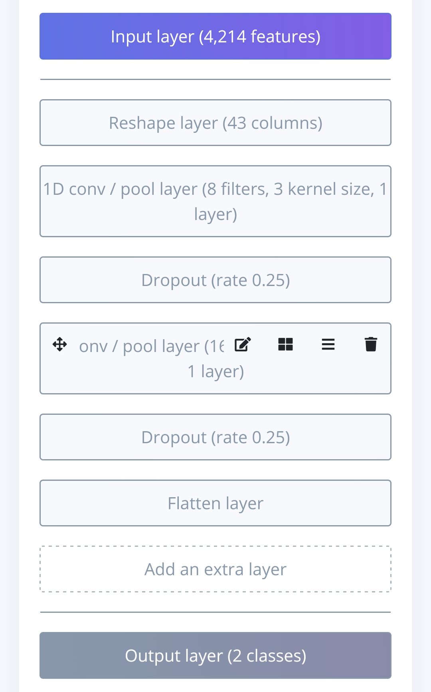
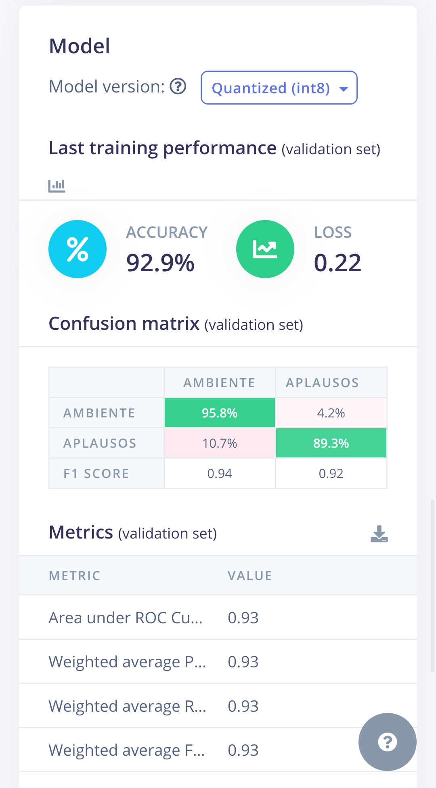
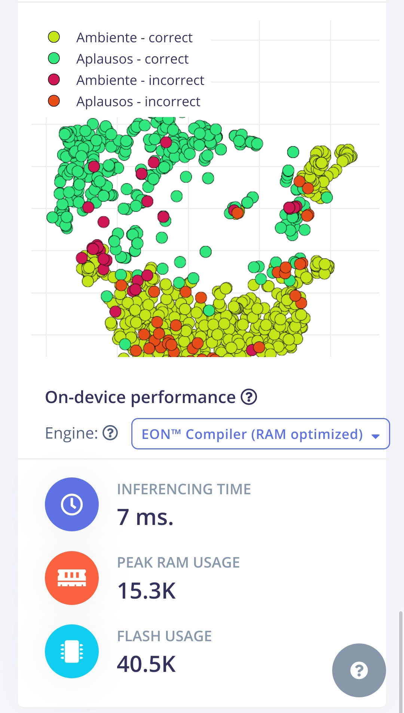

# Audiogenoma

Proyecto escolar de análisis de audio que combina dos enfoques: un **clasificador de sonidos** con aprendizaje automático y un sistema de **ADN visual** que traduce el audio a un código simbólico y a una visualización tipo mandala.

**Autores:** proyecto de colaboración entre Nicole Airam Becerra Cordero, Camila Pérez González, Samuel Isaac García Torres y Kevin Ramirez Soto, estudiantes de CONALEP Plantel Tlaquepaque.

---

## 1. Clasificador de audio (Edge Impulse)

Modelo que distingue dos clases: **Ambiente** y **Aplausos**.

- **Entrada:** 4,214 características de audio.
- **Arquitectura:** red neuronal convolucional 1D con dos bloques convolucionales, dropout de 0.25, capa de aplanado y salida de 2 clases.
- **Entrenamiento:** 135 ciclos, tasa de aprendizaje de 0.001, aumento de datos con ruido bajo, entrenado en CPU.
- **Modelo final:** cuantizado a int8; rendimiento estimado con EON Compiler (optimizado en RAM).

### Resultados

| Métrica | Valor |
|---|---|
| Exactitud en validación (296 muestras) | 92.9 % |
| Exactitud en prueba (269 muestras) | 89.2 % |
| Pérdida en validación | 0.22 |
| Área bajo la curva ROC (validación) | 0.93 |
| F1 en validación (Ambiente / Aplausos) | 0.94 / 0.92 |
| Tiempo de inferencia en dispositivo (estimado) | 7 ms |
| RAM pico / Flash (estimado) | 15.3 KB / 40.5 KB |

Matriz de confusión en validación: 95.8 % de aciertos en Ambiente y 89.3 % en Aplausos.





---

## 2. ADN visual (Python)

Sistema que convierte el audio en un código simbólico y lo dibuja como un mandala.

**Cómo funciona**

1. Captura audio en tiempo real, en ventanas de 0.5 segundos a 44.1 kHz.
2. Para cada ventana calcula la **frecuencia dominante** (transformada rápida de Fourier) y la **amplitud** (valor RMS).
3. Traduce ambos valores a un bloque de dos caracteres, por ejemplo `M3`: una letra que indica la banda de frecuencia (se usan cuatro bandas) y un número del 1 al 5 que indica el nivel de amplitud.
4. Dibuja un **mandala** en coordenadas polares, con una barra por bloque, coloreada según su banda de frecuencia.
5. Guarda el audio en `.wav` con fecha y hora, y la imagen del mandala en `.png`.

Incluye un modo con audio de prueba para ejecutarlo en entornos sin micrófono, como Google Colab.

---

## Tecnologías

Python, NumPy, SoundDevice, SoundFile, Matplotlib y Edge Impulse.

## Limitaciones

- El clasificador distingue solo dos clases.
- La exactitud en prueba (89.2 %) es menor que en validación (92.9 %).
- El tiempo de inferencia y el uso de memoria son estimaciones que entrega Edge Impulse.

## Estructura del repositorio

```
audiogenoma-clasificacion-audio/
├── README.md
├── LICENSE
├── arquitectura.png
├── metricas.png
└── explorador-datos.png
```

Este repositorio contiene únicamente la documentación del proyecto. El código fuente del sistema no se publica.

## Derechos

Audiogenoma es un proyecto de colaboración de sus autores (Nicole Airam Becerra Cordero, Camila Pérez González, Samuel Isaac García Torres y Kevin Ramirez Soto), quienes conservan en conjunto todos los derechos sobre él. No se permite usar, copiar, modificar ni distribuir el sistema ni su documentación sin autorización por escrito de los autores. Su revisión es posible solo a solicitud y con su autorización. Consulta el archivo [LICENSE](LICENSE).
